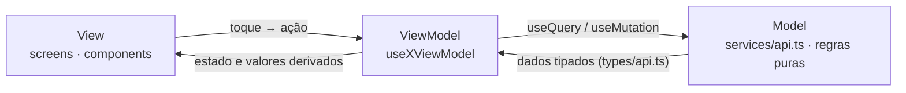

# Arquitetura do app — MVVM

O código do app segue o padrão **Model · View · ViewModel**. A ideia é uma só:
a tela desenha e repassa toques; quem decide o que ela mostra é o ViewModel; quem
sabe falar com o backend e fazer conta de domínio é o Model.

| Camada | Onde mora | O que faz |
|---|---|---|
| **Model** | `src/types/`, `src/services/` | O contrato com a API (`types/api.ts`), uma função por rota (`services/api.ts`) e as regras puras que não dependem de tela (`units.ts`, `simulation.ts`, `format.ts`, `prescriptionForm.ts`) |
| **ViewModel** | `src/viewmodels/` | Um hook por tela: `useHomeViewModel`, `useEconomyViewModel`... Guarda o estado, as queries e mutations do React Query, as ações e os valores derivados. Devolve um objeto simples |
| **View** | `src/screens/`, `src/components/` | Só JSX, estilo e eventos. Lê o objeto do ViewModel e chama as ações dele |



## A convenção

1. **A View não importa `services/api` nem `@tanstack/react-query`.** Também não
   importa `services/auth`: sair da conta é uma ação do ViewModel. O teste
   [`arquitetura.test.ts`](../mobile/src/viewmodels/__tests__/arquitetura.test.ts)
   verifica isso nas telas já migradas.
2. **Um ViewModel por tela**, em `src/viewmodels/use<Tela>ViewModel.ts`. O nome em
   inglês segue a regra do projeto; o comentário, em português.
3. **O ViewModel não devolve JSX nem estilo.** Ele devolve dado pronto para exibir
   (números já somados, listas já filtradas) e funções com nome de ação
   (`confirmar`, `sair`). Texto fixo de interface — rótulo, título, aviso — fica na
   View; texto que é resultado de uma decisão (qual próximo passo mostrar) pode vir
   do ViewModel, junto com a decisão.
4. **Regra pura continua no Model.** Se uma conta não depende de estado nem de
   query, ela vai para `services/` e o ViewModel só a chama. O ViewModel é a cola
   entre a tela e o Model, não um segundo lugar para regra de domínio.
5. **Navegação continua na View.** Callbacks como `onVoltar` e `onIr` chegam pela
   prop da tela e são chamados por ela; o ViewModel não conhece o navegador.

## Exemplo

```tsx
// viewmodels/useEconomyViewModel.ts
export function useEconomyViewModel(listId: string | null) {
  const lista = useQuery({ queryKey: ['shopping-list', listId], ... });
  return { estado, resumo, sair };
}

// screens/EconomyScreen.tsx
export default function EconomyScreen({ listId }: { listId: string | null }) {
  const vm = useEconomyViewModel(listId);
  if (vm.estado === 'carregando') return <Body muted>Carregando…</Body>;
  ...
}
```

## Testes

- **Teste de tela** (`screens/__tests__`) continua como estava: monta a tela com a
  API simulada e olha o que aparece. Ele não muda na migração — é ele que prova que
  o comportamento ficou igual.
- **Teste de ViewModel** (`viewmodels/__tests__`) usa `renderHook` e cobre o estado e
  as contas sem desenhar nada. É mais rápido e diz exatamente qual regra quebrou.

## Por que MVVM aqui

As telas maiores (`MarketScreen`, `PantryScreen`) passaram de 800 linhas misturando
layout, chamadas à API e regra de negócio. Separar o ViewModel deixa a tela legível,
permite testar a regra sem renderizar e mantém a mesma estrutura que o React Query
já sugere: o hook é o ViewModel natural num app React.
