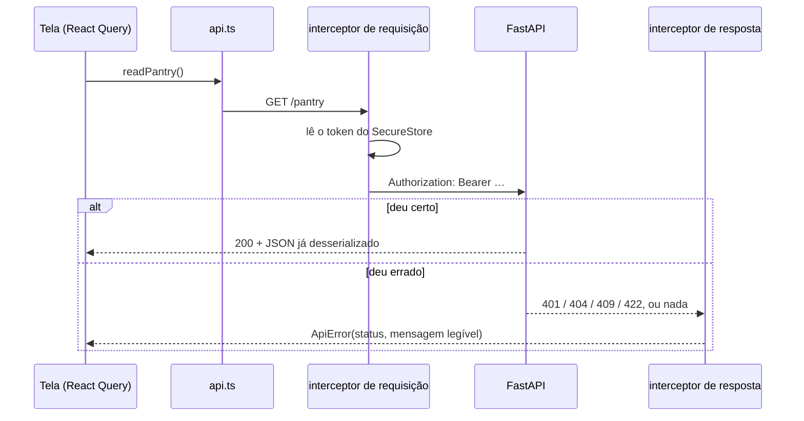

# Integração app ↔ API — como o aplicativo consome o backend

A DÉCADA são **dois sistemas separados**, não um. O aplicativo não tem banco de
dados: tudo que ele mostra na tela veio de uma chamada HTTP, e tudo que a pessoa
decide volta por outra. Este documento diz por onde essa conversa passa.

| | Quem é | Como fala |
|---|---|---|
| Cliente | React Native + Expo, TypeScript | axios sobre HTTP, corpo em JSON |
| Servidor | FastAPI + Pydantic v2, Python | 23 rotas de domínio, autenticadas por JWT, mais `/health` |
| Endereço | `EXPO_PUBLIC_API_URL`, em `mobile/.env` | Se não definido: na web, o host da própria página; no aparelho, o IP do host do Expo; `10.0.2.2` no emulador Android (ver `config.ts`). No compose o `mobile/.env` é ignorado (`EXPO_NO_DOTENV`) |

O endereço não é fixo em `localhost` de propósito: no emulador Android e no
celular físico ele aponta para o próprio aparelho, não para a máquina que roda o
backend. Por isso `config.ts` deduz o IP do computador a partir do Expo, e
`npm run dev:api-url` escreve o `.env` quando a dedução não servir.

## Onde isso mora no código

| Arquivo | Responsabilidade |
|---|---|
| [`mobile/src/services/http.ts`](../mobile/src/services/http.ts) | A instância do axios e os dois interceptors. **Política de comunicação** |
| [`mobile/src/services/api.ts`](../mobile/src/services/api.ts) | Uma função por rota do backend, e nada mais |
| [`mobile/src/services/session.ts`](../mobile/src/services/session.ts) | O token, guardado no Keychain/Keystore pelo `expo-secure-store` |
| [`mobile/src/services/config.ts`](../mobile/src/services/config.ts) | O endereço da API |
| [`mobile/src/types/api.ts`](../mobile/src/types/api.ts) | O contrato: os tipos que o backend devolve |

A separação entre os dois primeiros é o ponto: `api.ts` descreve **o quê**, e
`http.ts` resolve **como**. Nenhuma tela importa axios.

## O caminho de uma chamada



## Os dois interceptors

**O de requisição põe o token.** Toda chamada sai autenticada, exceto as que
ainda não têm token — login e cadastro, marcadas com `anonymous`. O token é
lido do armazenamento cifrado do sistema na hora do envio, nunca de uma
variável em memória.

**O de resposta traduz o erro.** Qualquer falha chega às telas como `ApiError`,
com `status` e uma mensagem que pode ser exibida. A tela nunca vê um erro do
axios, e por isso não precisa saber que existe axios.

Isso é o que a troca do `fetch` por axios comprou: antes, token e tratamento de
erro moravam dentro de uma função escrita à mão, e cada caminho novo tinha de
repetir os dois. Agora são política da instância — e veio de graça o **tempo
limite**, que não existia antes (15s nas chamadas, 60s no envio do PDF; sem
ele, rede ruim deixava a tela esperando para sempre).

## Quando a sessão cai

Ter um token guardado não prova que a sessão vale: ele pode ter vencido (7 dias),
ter sido assinado com outra `SECRET_KEY` ou ser de uma conta já excluída. Por isso
o app trata o `401` em dois momentos:

- **Na abertura.** Sem **Lembrar de mim** marcado no último login não há o que
  restaurar: o token só existiu em memória (`session.ts`), e a abertura cai no
  login. Com token guardado, o `AuthProvider` chama `GET /auth/me` antes
  de decidir entre login e app. `401` leva ao login. Qualquer outra falha — rede
  fora, servidor desligado — **mantém** a sessão: deslogar quem só está sem
  internet seria pior do que mostrar um erro de rede.
- **Durante o uso.** O interceptor de resposta vê todo `401` de chamada
  autenticada, apaga o token e avisa o `AuthProvider` (por `onSessionExpired`, em
  `http.ts`), que volta para o login com o aviso. Chamadas `anonymous` ficam de
  fora, porque lá `401` significa senha errada.

Sem isso, um token velho deixava a pessoa presa em telas que só devolviam
"credenciais inválidas", sem caminho de volta para o login. Os testes estão em
`services/__tests__/api.test.ts` e `auth.test.tsx`.

## O que o app consome

Das 40 rotas de domínio, o app consome 38. Ficam de fora
`GET /pantry/{item_id}/candidates` — a tela de despensa resolve a busca de
produto por `/products/search` — e `GET /shopping-lists/{id}/payments/{payment}`:
o pagamento simulado só muda de status pela confirmação, cuja resposta já traz o
pagamento atualizado, então não há o que consultar. O `/health` existe para saber se o servidor está
de pé; o app não o usa.

### Conta

| Método | Rota | Função em `api.ts` |
|---|---|---|
| POST | `/auth/register` | `register` |
| POST | `/auth/login` | `login` |
| POST | `/auth/nutritionist/register` | `registerNutritionist` |
| POST | `/auth/nutritionist/login` | `loginNutritionist` |
| GET | `/auth/me` | `readAccount` |
| DELETE | `/auth/me` | `deleteAccount` |

### Plano alimentar

| Método | Rota | Função |
|---|---|---|
| POST | `/meal-plans` | `importMealPlan` — multipart, o PDF |
| GET | `/meal-plans` | `readMealPlans` |
| GET | `/meal-plans/{id}` | `readMealPlan` |
| GET | `/meal-plans/{id}/items/{item}/candidates` | `readCandidates` |
| POST | `/meal-plans/{id}/items/{item}/confirmation` | `confirmItem` |
| POST | `/meal-plans/{id}/pantry-review` | `reviewPantry` — conclui a etapa Despensa; repetir não muda a data |

### Lista de compras

| Método | Rota | Função |
|---|---|---|
| POST | `/meal-plans/{id}/shopping-lists` | `generateShoppingList` |
| GET | `/meal-plans/{id}/shopping-lists` | `readShoppingLists` |
| GET | `/shopping-lists/{id}` | `readShoppingList` |
| POST | `/shopping-lists/{id}/simulation` | `simulateShoppingList` |
| POST | `/shopping-lists/{id}/items` | `addExtraItem` |
| DELETE | `/shopping-lists/{id}/items/{item}` | `removeShoppingListItem` |
| PATCH | `/shopping-lists/{id}/items/{item}` | `setItemPurchased` |

O `GET /shopping-lists/{id}` traz `outdated_items`, o que divergiu desde a geração. Cada
item tem um `change`: `produto_trocado`, `nao_confirmado` e `novo_confirmado` vêm do plano;
`despensa_alterada` diz que a despensa de hoje abateria daquela linha outra quantidade que a
gravada. O `ListaDesatualizada` escolhe o título por eles. Como a divergência da despensa é
calculada na leitura, cadastrar, editar ou remover item da despensa invalida
`['shopping-list']` além de `['pantry']`.

### Pagamento simulado

Nada é cobrado: o backend imita o Mercado Pago (ver
[`telas.md`](design/telas.md#3-mercado)). Toda resposta traz `simulated: true`.

| Método | Rota | Função |
|---|---|---|
| POST | `/shopping-lists/{id}/payments` | `payShoppingList` — Pix, ou cartão com os dados do formulário |
| GET | `/shopping-lists/{id}/payments` | `readPayments` — é por aqui que o checkout sabe que a lista já foi paga |
| POST | `/shopping-lists/{id}/payments/{payment}/confirmation` | `confirmPayment` — simula o Pix recebido ou o cartão que saiu da análise |

Cartão **recusado** volta `201` com `status: "recusado"`: é uma tentativa, não um
erro, e o `usePaymentViewModel` mostra o `status_detail` e deixa tentar de novo.

### Despensa, catálogo e receitas

| Método | Rota | Função |
|---|---|---|
| GET | `/pantry` | `readPantry` |
| POST | `/pantry` | `addPantryItem` |
| PATCH | `/pantry/{id}` | `updatePantryItem` |
| DELETE | `/pantry/{id}` | `removePantryItem` |
| POST | `/pantry/photo` | `recognizePantryPhoto` — multipart, só propõe; ver abaixo |
| GET | `/products/search` | `searchProducts` |
| GET | `/recipes/suggestions` | `readRecipeSuggestions` |

### Plano montado pela nutricionista

| Método | Rota | Função |
|---|---|---|
| GET | `/nutritionist/prescriptions` | `readPrescriptions` |
| POST | `/nutritionist/prescriptions` | `createPrescription` |
| GET | `/nutritionist/prescriptions/{id}` | `readPrescription` |
| PUT | `/nutritionist/prescriptions/{id}` | `updatePrescription` — 409 se o paciente já aceitou |
| DELETE | `/nutritionist/prescriptions/{id}` | `deletePrescription` |
| POST | `/nutritionist/prescriptions/{id}/send` | `sendPrescription` |
| GET | `/nutritionist/prescriptions/{id}/pdf` | `downloadPrescriptionPdf` — bytes, ver abaixo |

### Planos recebidos pelo paciente

| Método | Rota | Função |
|---|---|---|
| GET | `/prescriptions/received` | `readReceivedPrescriptions` |
| POST | `/prescriptions/received/{id}/accept` | `acceptPrescription` — devolve o mesmo corpo do import |
| POST | `/prescriptions/received/{id}/decline` | `declinePrescription` |

**O papel escolhe a navegação; quem barra é o servidor.** O login devolve `role` junto
com o token, e a sessão guarda o papel (`session.ts`) para o app abrir na navegação certa
mesmo sem rede. A rota do outro papel responde 404, e é essa resposta que vale, não o que
o app escondeu.

**O PDF do plano vem pela instância do axios**, com `responseType: 'arraybuffer'` e o
token no cabeçalho, como qualquer chamada. Não é um link aberto no navegador porque o
token teria de ir na URL. Quem entrega o arquivo é `services/download.ts`: no navegador,
um link de download; no celular, `expo-file-system` grava no cache e `expo-sharing` abre
a folha de compartilhar.

## Erro: o que cada status significa na tela

| Status | O que é | O que a tela faz |
|---|---|---|
| `0` | O servidor não respondeu — rede fora, ou tempo esgotado | "não foi possível falar com o servidor em `http://…:8000` — …", com o endereço que o app tentou. Não é bug do app nem do backend |
| `401` | Sessão expirada, token adulterado ou conta excluída | Apaga o token, volta para o login e avisa "sua sessão expirou, entre de novo". No login e no cadastro, o `401` é só senha errada — ou conta do outro papel, que responde igual de propósito: a mensagem aparece no formulário e nada é apagado |
| `404` | Recurso que não existe, **que é de outra pessoa**, ou rota do outro papel | Trata como inexistente |
| `409` | Conflito — produto que já está na lista, plano que o paciente já aceitou, lista já paga ou pagamento que não está mais pendente | Mostra a mensagem do servidor |
| `413` | Foto da despensa acima de 10 MB | Mostra a mensagem do servidor |
| `422` | Regra de negócio ou validação — PDF sem texto, item da prescrição que não pode sair da lista, foto sem aceite, cartão com número, validade ou CVV inválido | Mostra a mensagem do servidor |
| `503` | O reconhecimento da foto não respondeu, recusou a foto ou não está configurado (sem `ANTHROPIC_API_KEY`) | Mostra a mensagem do servidor. Não é erro de quem enviou: vale tentar de novo ou digitar o item |

O `0` não é um status HTTP: é a marca de que não houve resposta. Sem ele, "o
servidor recusou" e "o servidor não respondeu" chegariam iguais na tela.

O `404` para recurso de outra pessoa é decisão de projeto, não descuido:
responder `403` confirmaria que o recurso existe. Ver
[`lgpd.md`](lgpd.md) e a decisão 10 do `CLAUDE.md`.

A mensagem vem do campo `detail` da FastAPI. Quando o `detail` é a lista de
erros de validação do Pydantic, o cliente extrai o primeiro `msg`.

## O envio do PDF é o caso especial

É a única chamada que não vai em JSON: o plano alimentar sobe como
`multipart/form-data`. O formato do arquivo **difere entre web e nativo** —
no React Native vai um descritor `{ uri, name, type }`; no navegador é preciso
ler o conteúdo e enviar um `Blob`. Errar isso faz o servidor receber a string
`"[object Object]"` e recusar o envio.

O token continua vindo do interceptor, como em qualquer outra chamada.

**A foto da despensa segue o mesmo caminho**, em `recognizePantryPhoto`: multipart, com
a diferença entre web e nativo tratada do mesmo jeito, e `consent_accepted` no
formulário. O tempo limite é de 90 s, porque além de subir a foto a requisição espera o
reconhecimento. A resposta é `{ items: [{ name, identified, candidates }] }` e não muda
nada no servidor: cada item que a pessoa confirma vai depois pelo `addPantryItem`.

A foto vem do `expo-image-picker`, com `quality: 0.7` e `exif: false`. O servidor não
confia nisso: confere o formato pelo conteúdo (JPEG, PNG ou WebP; o resto é 400) e
regrava a imagem antes de enviá-la.

## Como verificar que funciona

São duas camadas, e elas provam coisas diferentes.

**Contrato** — [`mobile/src/services/__tests__/api.test.ts`](../mobile/src/services/__tests__/api.test.ts),
15 casos sobre um adaptador falso do axios. Não precisa de servidor:

```bash
cd mobile && npm test
```

**Ponta a ponta** — [`mobile/e2e/smoke.e2e.ts`](../mobile/e2e/smoke.e2e.ts),
o cliente real contra o backend real. Precisa do Postgres e da API de pé, com o
catálogo de desenvolvimento carregado:

```bash
docker compose up -d db api                        # banco + API em localhost:8000
docker compose exec api python -m app.seeds        # só na primeira vez: catálogo fictício
cd mobile && npm run test:smoke
```

Sem Docker para a API, suba só o banco (`docker compose up -d db`) e rode o seed e
o uvicorn à mão, como no README. Para apontar para outro servidor, defina
`EXPO_PUBLIC_API_URL` antes do comando.

Ele percorre o caminho inteiro e cria uma conta própria, que apaga no último
passo: cadastro → `/auth/me` → PDF do plano por multipart → confirmação item a
item → lista de compras com custo → busca no catálogo → despensa → receitas →
o `204` do DELETE → o `401` da senha errada → exclusão da conta.

Fica fora da suíte comum de propósito: sem servidor de pé ele falharia, e
`npm test` tem de poder rodar sozinho.

### O que é um smoke test, e por que este projeto tem um

O nome vem da eletrônica: liga-se a placa nova e olha-se se sai fumaça. Em
software, *smoke test* é um teste **largo e raso**: em vez de examinar uma regra a
fundo, ele passa uma vez pelo caminho principal do sistema montado de verdade e
responde a uma pergunta só — *as peças ligadas funcionam juntas?* Se ele falha, não
adianta testar mais nada; se passa, o resto dos testes tem um sistema em que
confiar.

A DÉCADA são dois sistemas que só se falam por HTTP (ver o início deste
documento), e cada um tem a sua suíte:

| Suíte | Roda contra | Prova | Não alcança |
|---|---|---|---|
| `pytest` (backend) | FastAPI + Postgres de teste | regras de negócio, rotas, LGPD | se o app sabe chamar as rotas |
| `npm test` (app) | adaptador falso do axios, API simulada | telas, ViewModels, o contrato **como o app o imagina** | se o servidor responde daquele jeito |
| `npm run test:smoke` | o `api.ts` real contra a API real | que os dois lados concordam | detalhes de cada regra |

O buraco entre as duas primeiras linhas é exatamente onde mora o tipo de erro que
mais aparece num app dividido em cliente e servidor: cada lado passa nos seus
testes e, juntos, não funcionam. Alguns que o smoke pega e as outras suítes não:

- **Contrato divergente.** `types/api.ts` diz um nome de campo e o Pydantic devolve
  outro. O teste do app usa o tipo que ele mesmo declarou e passa; o do backend usa
  o schema dele e passa.
- **Multipart.** O PDF sobe como `multipart/form-data`, e o formato do arquivo difere
  entre web e nativo (seção acima). Só um servidor de verdade diz se recebeu o
  arquivo ou a string `"[object Object]"`.
- **Os status sem corpo e os de erro.** O `204` do `DELETE` precisa ser aceito sem
  tentar ler JSON; o `401` da senha errada precisa chegar ao app como `ApiError`,
  marcado como não autorizado e com a mensagem que o servidor escreveu.
- **Token de verdade.** O JWT assinado pelo backend volta no interceptor e abre as
  rotas protegidas; depois da exclusão da conta, o mesmo token deixa de valer
  (decisão 9). Nenhum mock assina token.
- **Banco, migração e seed.** Se uma migração não rodou ou o catálogo não foi
  carregado, o casamento não acha produto e a lista sai sem preço — o smoke confere
  que o PDF de exemplo vira 15 itens com candidato e uma lista com total.

Ele cria uma conta própria e a apaga no último passo: o teste não deixa dado de
saúde para trás (decisão 5) e pode rodar em qualquer banco de desenvolvimento.

**Quando rodar:** antes de juntar uma branch que mexa em `api.ts`, `http.ts`,
`types/api.ts` ou nas rotas do backend, antes de uma demonstração e depois de
publicar a API.

**O que ele não cobre:** a interface (quem desenha é o `npm test`), o adaptador de
rede do celular (aqui o axios usa o de Node, ver o comentário no arquivo), a despensa
por foto (precisa da chave da Anthropic e custa uma chamada paga) e a área da
nutricionista.

**Por que não está no CI:** o CI já sobe um Postgres para o `pytest`, mas não sobe a
API nem roda o seed para o app. Enquanto isso não existir, o smoke depende de alguém
rodá-lo — e isso tem custo: em 21/10/2026 ele estava quebrado sem ninguém ter
notado. O `config.ts` passou a usar o `expo-constants` em 13/10, e o mock do smoke
não acompanhou (corrigido em `f702c53`). Colocá-lo no CI é o próximo passo natural.
